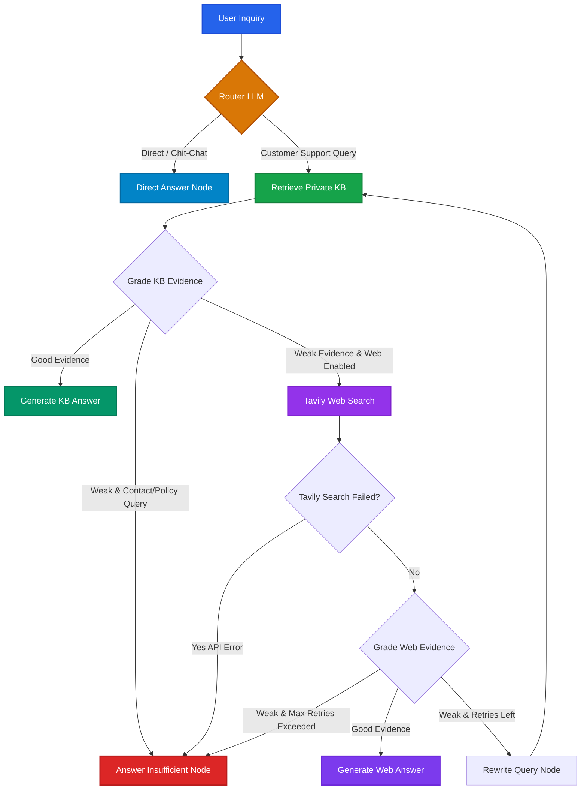

<div align="center">
  
# 🤖 Agentic RAG — Customer Support AI
  
**An enterprise-grade, self-correcting Retrieval-Augmented Generation (RAG) system with dynamic routing, knowledge base fallback, query rewriting, and real-time streaming.**

[](https://python.org)
[](https://fastapi.tiangolo.com)
[](https://langchain.com/langgraph)
[](https://langchain.com)
[](https://pinecone.io)
[](https://groq.com)
[](https://tavily.com)
[](tests/)
[](LICENSE)

</div>

---

## 🌟 Overview

**Agentic RAG Customer Support** is a production-hardened intelligent assistant built using **LangGraph**, **LangChain**, **FastAPI**, and **React 19**. 

Unlike conventional static RAG architectures that blindly inject database lookups into prompts, this agentic architecture acts as an autonomous reasoning loop:
1. **Intelligent Query Routing**: Distinguishes between conversational chit-chat / greetings and customer support inquiries.
2. **Private Knowledge Base Retrieval**: Queries a Pinecone vector database populated with domain documentation.
3. **Automated Evidence Grading**: An LLM grader evaluates whether retrieved context is sufficient and relevant (with optional similarity-score threshold bypass via `SKIP_GRADER_SCORE`).
4. **Autonomous Web Search Fallback**: Seamlessly switches to real-time Tavily web search if internal documents are missing or stale.
5. **Self-Correction & Query Rewriting**: Rewrites ambiguous search queries and retries retrieval up to configurable retry limits.
6. **Graceful Error & Context Handling**: Prevents API error leakages and falls back cleanly if information cannot be verified.
7. **Real-time SSE Streaming**: Emits live reasoning steps (`status`), token chunks (`token`), and structured conclusions (`done`) to the frontend.

---

## 🏗️ Architecture & Decision Graph

The agent's state machine is compiled with **LangGraph**:



### Graph Execution Nodes

| Node Name | Identifier | Purpose |
| :--- | :--- | :--- |
| **Route Question** | `route_question` | Classifies query intent as `kb` (technical support) or `direct` (greetings/general). |
| **Retrieve KB** | `retrieve_kb` | Fetches top matching vector embeddings and similarity scores from Pinecone. |
| **Grade KB Evidence** | `grade_kb_evidence` | Evaluates if private documents are sufficient (or bypasses LLM if similarity >= `SKIP_GRADER_SCORE`). |
| **Search Web** | `search_web` | Queries Tavily API with timeout for real-time web results if KB evidence is weak. |
| **Grade Web Evidence** | `grade_web_evidence` | Evaluates accuracy and relevance of external search snippets while filtering external contacts. |
| **Rewrite Query** | `rewrite_query` | Reformulates search terms using prior context when retrieval fails. |
| **Generate From KB** | `generate_from_kb` | Synthesizes customer answer grounded strictly in private KB context. |
| **Generate From Web** | `generate_from_web` | Synthesizes response grounded strictly in verified web search results. |
| **Direct Answer** | `direct_answer` | Delivers quick polite answers for general inquiries and greetings. |
| **Answer Insufficient** | `answer_insufficient` | Gracefully notifies the user when evidence is insufficient or external search fails. |

---

## 🛡️ Production Hardening & Security

This codebase implements production-grade security and reliability patterns:

- ⚡ **Async-First Execution**: All graph nodes are implemented as native `async def` using `ainvoke` for LLM calls and `asyncio.to_thread` for Pinecone and FastEmbed operations, preventing event-loop blocking under high concurrent loads.
- 🔒 **API Key Authentication**: Configurable `X-API-Key` header authentication (using constant-time `hmac.compare_digest`). Set `REQUIRE_API_KEY=true` to enforce key presence at startup (unset `API_KEY` leaves endpoints public).
  > [!NOTE]
  > Storing an API key in a client-side browser bundle (e.g., `VITE_API_KEY`) is not secure against inspection. For high-security environments, route requests through a backend authentication proxy.
- 🛑 **Rate Limiting Behind Proxies**: Integrated **SlowAPI** client throttling (default `20/minute` per client IP) configured with `--proxy-headers` and `--forwarded-allow-ips`.
- 📏 **Input Caps & Sanitization**: Validates user messages (1 to 1,500 characters), trims whitespace, and prevents blank session hijacking via clean UUID generation. Hostile thread IDs containing traversal characters or script tags are sanitized into safe slugs.
- 🛡️ **Prompt Injection Hardening**: Prompts deliver separate `SystemMessage` instructions and `HumanMessage` turns. Untrusted retrieval data is wrapped in `<context>...</context>` delimiters with strict instructions to treat context as passive data, never directives.
- 🧩 **Zero Import Side-Effects**: Settings and client factories are lazily initialized. Importing any module or running tests does not trigger network requests or environment side effects.
- 🔁 **Deterministic Ingestion**: Document chunks are hashed deterministically using SHA-256 (`{intent}_{content}`) for idempotent upserts.
- 🌐 **Strict CORS Policies**: Dynamic origin resolution from `ALLOWED_ORIGINS` without wildcard regex.

---

## 🧰 Tech Stack

| Layer | Technologies |
| :--- | :--- |
| **Backend Framework** | FastAPI 0.115+, Uvicorn 0.30+, Pydantic v2, Pydantic Settings |
| **Agent Orchestration** | LangGraph 1.2+, LangChain 1.3+ |
| **State Persistence** | SqliteSaver (`CHECKPOINT_DB`) / MemorySaver (dev-only) |
| **LLM Inference** | Groq LPU (`openai/gpt-oss-20b` or LLaMA-3.3-70b-versatile) |
| **Vector Database** | Pinecone Vector Database (`pinecone>=7.3.0`) |
| **Embeddings** | FastEmbed (`sentence-transformers/all-MiniLM-L6-v2`, 384 dimensions) |
| **Search Engine** | Tavily Search API (`langchain-tavily>=0.2.18`) |
| **Rate Limiter** | SlowAPI 0.1.10+ |
| **Frontend UI** | React 19, TypeScript, Vite, Tailwind CSS v4, Lucide Icons |
| **Packaging & CI** | Astral `uv`, GitHub Actions, Pytest, HTTPX, Mypy, Ruff |

---

## 📂 Project Structure

```
Agentic-RAG/
├── .github/workflows/
│   └── ci.yml               # Automated CI (Ruff, Mypy, Pytest with >=70% coverage, Frontend build)
├── src/agenticrag/
│   ├── __init__.py          # Package export and versioning
│   ├── api.py               # FastAPI application, middleware, routes
│   ├── auth.py              # Constant-time API key verification dependencies
│   ├── cli.py               # Command-line interface (`agenticrag serve`, `agenticrag ingest`)
│   ├── clients.py           # Lazy client factories (LLM, vectorstore, search, embeddings)
│   ├── config.py            # Pydantic Settings and get_settings singleton
│   ├── constants.py         # Shared constants (EMBEDDING_DIM, RETRIEVER_K, DATASET_NAME)
│   ├── graph.py             # LangGraph state machine assembly with Sqlite/Memory checkpointer
│   ├── ingest.py            # Idempotent Pinecone dataset ingestion pipeline (seeded sampling)
│   ├── models.py            # Pydantic API schemas (ChatRequest, ChatResponse, KBSearchRequest)
│   ├── node_meta.py         # Presentation metadata, node statuses, and generation flags
│   ├── nodes.py             # Pure decision edges and async state execution nodes
│   ├── prompts.py           # Persona prompts and untrusted context wrappers
│   ├── schemas.py           # Structured output schemas (RouteDecision, EvidenceGrade)
│   └── sse.py               # SSE frame formatter and async streaming generator
├── frontend/                # Modern React 19 + TypeScript + Tailwind v4 UI
│   ├── src/                 # Chat interface, SSE stream parser, source badges
│   └── package.json
├── tests/
│   ├── test_api.py          # API validation, auth, input caps, and thread_id tests
│   ├── test_graph_e2e.py    # Complete 5-path end-to-end state graph test suite
│   ├── test_nodes.py        # Async node tests with stubs, fallbacks, and score thresholds
│   ├── test_routing.py      # Pure decision edge tests and smoke validations
│   └── test_sse_contract.py # Server-Sent Events frame and error-path contract tests
├── .env.example             # Documented template of all configuration variables
├── Dockerfile               # Single-stage production container with FastEmbed pre-caching
├── LICENSE                  # MIT License
├── pyproject.toml           # Project dependencies managed via `uv`
└── README.md
```

---

## ⚙️ Configuration & Environment Variables

Copy `.env.example` to `.env`:

```bash
cp .env.example .env
```

| Variable | Default | Purpose |
| :--- | :--- | :--- |
| `GROQ_API_KEY` | `""` | Groq API key for LLM generation |
| `PINECONE_API_KEY` | `""` | Pinecone API key for vector store retrieval |
| `TAVILY_API_KEY` | `""` | Tavily API key for web search fallback |
| `API_KEY` | `""` | Optional secret token for `X-API-Key` auth (empty = public API) |
| `REQUIRE_API_KEY` | `false` | When true, server startup aborts if `API_KEY` is empty |
| `ALLOWED_ORIGINS` | `http://localhost:5173,...` | Comma-separated CORS allowed origin list |
| `RATE_LIMIT` | `20/minute` | Rate limit for chat endpoints |
| `MAX_MESSAGE_LENGTH` | `1500` | Max character length for user questions |
| `MAX_THREAD_HISTORY` | `10` | Max previous conversation turns passed as history |
| `WEB_FALLBACK_ENABLED` | `true` | When false, web search fallback is skipped |
| `SKIP_GRADER_SCORE` | `""` | Top similarity threshold (e.g. `0.85`) to bypass LLM grading |
| `CHECKPOINT_DB` | `""` | SQLite file path for state checkpointer (in-memory if unset) |
| `KB_SAMPLE_SIZE` | `500` | Sample rows to index from Bitext dataset (toy-KB limitation) |
| `KB_SEED` | `42` | Random seed for dataset sampling |

> [!NOTE]
> **Knowledge Base Sample Size**: By default, `ingest.py` indexes a seeded sample of 500 rows (`KB_SAMPLE_SIZE=500`) from the Bitext Customer Support dataset (`bitext/Bitext-customer-support-llm-chatbot-training-dataset`) to ensure quick setup and stay within free-tier vector database quotas. Increase this value in `.env` if you wish to index the complete dataset.

---

## 🚀 Quick Start Guide

### 1. Prerequisites
- **Python 3.12+**
- **uv** (Astral's fast Python package manager)
- **Node.js 18+** & npm (for frontend)

### 2. Installation
```bash
git clone https://github.com/tilakchow/agentic-customer-support-rag.git
cd agentic-customer-support-rag

# Sync backend virtual environment
uv sync
```

### 3. Knowledge Base Ingestion
To run the ingestion pipeline, install the optional `ingest` extra:
```bash
uv sync --extra ingest
uv run agenticrag ingest
```

### 4. Run the Backend API
Start the FastAPI server via the CLI tool:
```bash
uv run agenticrag serve --port 8000 --reload
```
Or directly with Uvicorn:
```bash
uv run uvicorn agenticrag.api:app --reload --host 0.0.0.0 --port 8000
```

- **Interactive API Docs (Swagger)**: `http://localhost:8000/docs`
- **Health Check Endpoint**: `http://localhost:8000/health`
- **Knowledge Base Stats**: `http://localhost:8000/kb/info`

### 5. Run the Frontend UI
```bash
cd frontend
npm install
npm run dev
```
Open **`http://localhost:5173`** in your browser.

---

## 🔌 API Endpoints & Contracts

### `POST /chat` — Synchronous Chat
```json
// Request
{
  "message": "How do I update my billing payment method?",
  "thread_id": "optional-custom-session-id"
}

// Response
{
  "response": "To update your payment method, navigate to...",
  "source_used": "private_kb",
  "thread_id": "optional-custom-session-id"
}
```

### `POST /chat/stream` — Real-Time SSE Stream
Streams Server-Sent Events representing reasoning transitions and tokens:
- **`status`**: Agent step update (e.g., `{"type": "status", "node": "retrieve_kb", "message": "Searching private knowledge base..."}`)
- **`token`**: Real-time token chunk generated by the LLM (`{"type": "token", "token": "..."}`)
- **`done`**: Final structured response payload containing `{"type": "done", "thread_id": "...", "source_used": "...", "full_content": "..."}`
- **`error`**: Masked error notification in case of exceptions (`{"type": "error", "error": "..."}`)

---

## 🧪 Testing & Quality Assurance

The codebase includes 52 unit, integration, and end-to-end tests:

```bash
# Run pytest with coverage gate (fails under 70%)
uv run pytest tests/ -v --cov=src/agenticrag --cov-fail-under=70

# Run lint and formatting checks
uv run ruff check .
uv run ruff format --check .
uv run mypy src/ --ignore-missing-imports
```

---

## 🐳 Docker Deployment

The repository includes a single-stage `python:3.14-slim` `Dockerfile` with non-root security (`appuser`), a pre-cached FastEmbed model, and container health checks:

```bash
# Build Docker image
docker build -t agentic-customer-support-rag .

# Run container locally
docker run -p 7860:7860 \
  -e GROQ_API_KEY="your_groq_key" \
  -e PINECONE_API_KEY="your_pinecone_key" \
  -e TAVILY_API_KEY="your_tavily_key" \
  agentic-customer-support-rag
```

---

## 👨‍💻 Author

**Tilak chowdary**  
- **Email**: [tilakchowdary18@gmail.com](mailto:tilakchowdary18@gmail.com)  
- **Repository**: [tilakchow/agentic-customer-support-rag](https://github.com/tilakchow/agentic-customer-support-rag)
