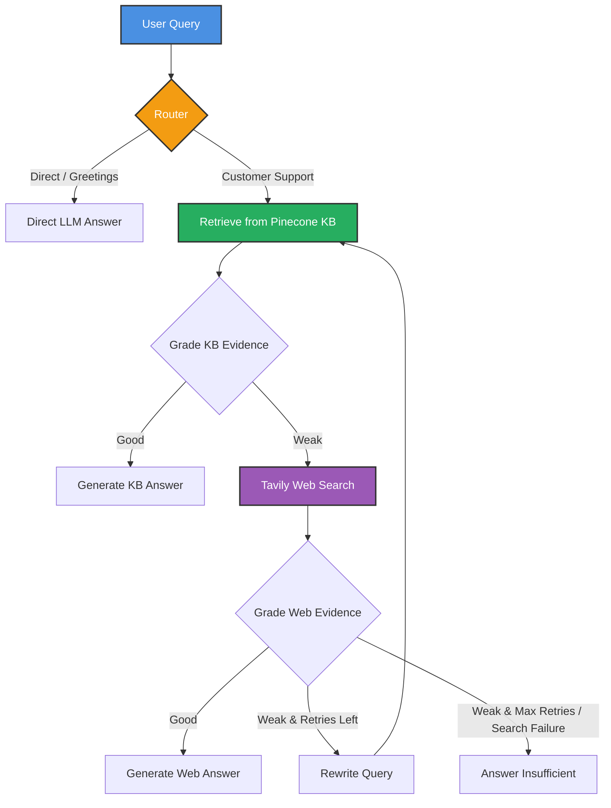

<div align="center">
  
# 🤖 Agentic RAG - Customer Support AI
  
**An advanced, self-correcting Retrieval-Augmented Generation (RAG) system built with intelligent agentic capabilities using LangGraph, LangChain, Groq, Pinecone, and Tavily.**

[](https://python.org)
[](https://langchain.com)
[](https://langchain.com/langgraph)
[](https://pinecone.io)
[](https://groq.com)
[](tests/)

</div>

---

## 🌟 Overview

This project implements an **Agentic RAG pipeline** tailored for **Customer Support**. Unlike traditional static RAG, this system uses intelligent agents that dynamically decide how to answer a query. 

It evaluates retrieved evidence, falls back to real-time web searches when internal documentation is insufficient, rewrites queries if retrieval fails, and streams responses to a modern React interface.

---

## 🏗️ Architecture & Workflow

The agent follows an industry-standard decision graph:



---

## 🧰 Tech Stack

| Component | Technology Used |
| :--- | :--- |
| **Backend API** | FastAPI, Uvicorn (uv-managed, async concurrency) |
| **Frontend** | React 19, TypeScript, Vite, Tailwind CSS v4, Lucide |
| **Agent Framework** | LangGraph, LangChain |
| **LLM Provider** | Groq (`openai/gpt-oss-20b`) |
| **Vector Database** | Pinecone (`industry-agentic-rag-kb`) |
| **Embeddings** | FastEmbed (`sentence-transformers/all-MiniLM-L6-v2`, 384-d) |
| **Web Search** | Tavily Search API |
| **Rate Limiting** | SlowAPI (IP-based throttling) |
| **Testing** | Pytest, Pytest-Asyncio, HTTPX |

---

## 🚀 Setup Instructions

### 1. Clone the Repository
```bash
git clone https://github.com/tilakchow/agentic-customer-support-rag.git
cd agentic-customer-support-rag
```

### 2. Configure Environment Variables
Create a `.env` file in the root directory:
```env
GROQ_API_KEY=your_groq_api_key
PINECONE_API_KEY=your_pinecone_api_key
TAVILY_API_KEY=your_tavily_api_key
# Optional: Set API_KEY if you want to require authorization on endpoints
API_KEY=
```

### 3. Install Dependencies
```bash
uv sync
```

### 4. Ingest Knowledge Base Data (Idempotent)
Populate your Pinecone index with deterministic chunk IDs:
```bash
uv run agenticrag ingest
```

---

## 💻 Running the Application

### 1. Start the FastAPI Backend
Using the CLI:
```bash
uv run agenticrag serve --port 8000 --reload
```
Or directly with Uvicorn:
```bash
uv run uvicorn agenticrag.api:app --reload --port 8000
```
- Interactive Swagger Docs: `http://localhost:8000/docs`
- Health check: `http://localhost:8000/health`
- Streaming chat: `POST http://localhost:8000/chat/stream`

### 2. Start the React Frontend
```bash
cd frontend
npm install
npm run dev
```
Open `http://localhost:5173` in your browser.

---

## 🧪 Testing & Verification

Run the automated test suite:
```bash
uv run pytest tests/ -v
```

Run the smoke test script:
```bash
uv run python test_run.py
```

---

## 👨‍💻 Author

**Tilak chowdary**  
📧 [tilakchowdary5@gmail.com](mailto:tilakchowdary5@gmail.com)
