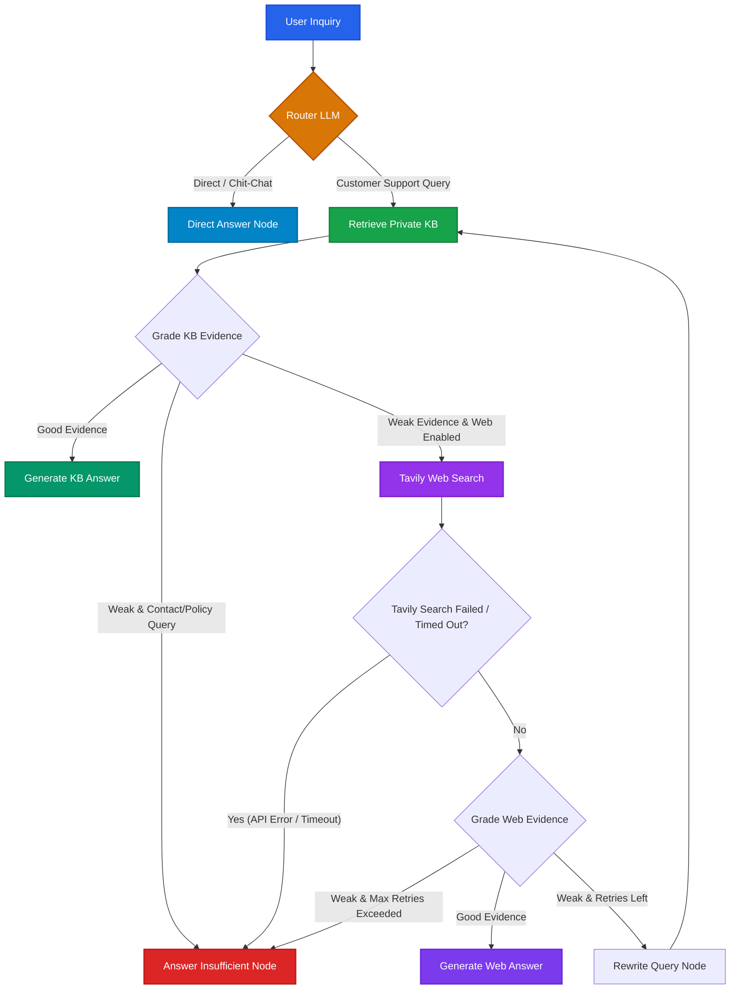

<div align="center">
  
# 🤖 Agentic RAG — Customer Support AI
  
**A production-ready, self-correcting Retrieval-Augmented Generation (RAG) system with dynamic routing, knowledge base fallback, query rewriting, and real-time streaming.**

[](https://python.org)
[](https://fastapi.tiangolo.com)
[](https://langchain.com/langgraph)
[](https://langchain.com)
[](https://pinecone.io)
[](https://groq.com)
[](https://tavily.com)
[](tests/)
[](tests/)
[](LICENSE)

</div>

---

## 🌟 Overview

**Agentic RAG Customer Support** is a production-hardened intelligent assistant built using **LangGraph**, **LangChain**, **FastAPI**, and **React 19**. 

Unlike conventional static RAG architectures that blindly inject database lookups into prompts, this agentic architecture acts as an autonomous reasoning loop:
1. **Intelligent Query Routing**: Distinguishes between conversational chit-chat / greetings and customer support inquiries.
2. **Private Knowledge Base Retrieval**: Queries a Pinecone vector database populated with domain documentation.
3. **Automated Evidence Grading**: An LLM grader evaluates whether retrieved context is sufficient and relevant (with optional similarity-score threshold bypass via `SKIP_GRADER_SCORE`).
4. **Autonomous Web Search Fallback**: Seamlessly switches to real-time Tavily web search with configured timeouts and concurrency throttles if internal documents are missing or stale.
5. **Self-Correction & Query Rewriting**: Rewrites ambiguous search queries and retries retrieval up to configurable retry limits.
6. **Graceful Error & Context Handling**: Prevents API error leakages and falls back cleanly if information cannot be verified.
7. **Thread Memory Bounding**: Limits memory consumption by automatically trimming conversation thread messages beyond `MAX_THREAD_MESSAGES`.
8. **Real-time SSE Streaming**: Emits live reasoning steps (`status`), token chunks (`token`), and structured conclusions (`done`) to the frontend.

---

## 🏗️ Architecture & Decision Graph

The agent's state machine is compiled with **LangGraph**:



### Graph Execution Nodes

| Node Name | Identifier | Purpose |
| :--- | :--- | :--- |
| **Route Question** | `route_question` | Classifies query intent as `kb` (technical support) or `direct` (greetings/general). |
| **Retrieve KB** | `retrieve_kb` | Fetches top matching vector embeddings and similarity scores from Pinecone via worker threads (`asyncio.to_thread`). |
| **Grade KB Evidence** | `grade_kb_evidence` | Evaluates if private documents are sufficient (or bypasses LLM if similarity >= `SKIP_GRADER_SCORE`). |
| **Search Web** | `search_web` | Queries Tavily API with timeout (`TAVILY_TIMEOUT_SECONDS`) and concurrency limit (`TAVILY_MAX_CONCURRENCY`) if KB evidence is weak. |
| **Grade Web Evidence** | `grade_web_evidence` | Evaluates accuracy and relevance of external search snippets while filtering external contacts. |
| **Rewrite Query** | `rewrite_query` | Reformulates search terms using prior context when retrieval fails. |
| **Generate From KB** | `generate_from_kb` | Synthesizes customer answer grounded strictly in private KB context. |
| **Generate From Web** | `generate_from_web` | Synthesizes response grounded strictly in verified web search results. |
| **Direct Answer** | `direct_answer` | Delivers quick polite answers for general inquiries and greetings. |
| **Answer Insufficient** | `answer_insufficient` | Gracefully notifies the user when evidence is insufficient or external search fails. |

---

## 🛡️ Production Hardening & Security

This codebase implements production-grade security and reliability patterns:

- ⚡ **Async-First Execution & Cold-Start Warmup**: Graph nodes execute asynchronously. FastEmbed embeddings and LLM clients are pre-warmed during FastAPI `lifespan` startup, and initializers are guarded with `threading.Lock` to avoid concurrent initialization races.
- 🗄️ **Persistent Checkpointer Lifecycle**: In production (`ENVIRONMENT=production`), the backend refuses to start without a persistent database configured via `CHECKPOINT_DB` (or explicit `ALLOW_IN_MEMORY_CHECKPOINTS=true`). Database connections are managed cleanly within the FastAPI lifespan context manager.
- 🧵 **State & Memory Bounding**: In-memory and persistent threads are bounded using `trim_messages_reducer`, retaining at most `MAX_THREAD_MESSAGES` (default 40) turns per thread.
- 🛑 **Rate Limiting & Anti-Spoofing**: Rate limiting (default `20/minute`) uses `TRUSTED_PROXIES` configuration. When behind trusted proxies, the rightmost untrusted IP in the `X-Forwarded-For` chain is extracted to prevent client spoofing. Direct client IP is used when proxies are not trusted.
- 🔒 **API Key Authentication**: Configurable `X-API-Key` header authentication (using constant-time `hmac.compare_digest`). Set `REQUIRE_API_KEY=true` to enforce key presence at startup.
- 🛡️ **Prompt Injection Hardening**: Prompts deliver separate `SystemMessage` instructions and `HumanMessage` turns. Untrusted retrieval data is wrapped in `<context>...</context>` delimiters with strict instructions to treat context as passive data, never directives.
- 🔁 **Deterministic Ingestion**: Document chunks are hashed deterministically using SHA-256 (`{intent}_{content}`) for idempotent upserts.
- 🌐 **Strict CORS Policies**: Dynamic origin resolution from `ALLOWED_ORIGINS` without wildcard regex.

---

## 🧰 Tech Stack

| Layer | Technologies |
| :--- | :--- |
| **Backend Framework** | FastAPI 0.115+, Uvicorn 0.30+, Pydantic v2, Pydantic Settings |
| **Agent Orchestration** | LangGraph 1.2+, LangChain 1.3+ |
| **State Persistence** | AsyncSqliteSaver (`CHECKPOINT_DB`) / MemorySaver (dev/ephemeral) |
| **LLM Inference** | Groq LPU (`openai/gpt-oss-20b` or LLaMA-3.3-70b-versatile) |
| **Vector Database** | Pinecone Vector Database (`pinecone>=7.3.0`) |
| **Embeddings** | FastEmbed (`sentence-transformers/all-MiniLM-L6-v2`, 384 dimensions) |
| **Search Engine** | Tavily Search API (`langchain-tavily>=0.2.14`) |
| **Rate Limiter** | SlowAPI 0.1.10+ |
| **Frontend UI** | React 19, TypeScript, Vite, Tailwind CSS v4, Lucide Icons |
| **Packaging & CI** | Astral `uv`, GitHub Actions, Pytest, Vitest, Mypy, Ruff, pip-audit |

---

## ⚙️ Configuration & Environment Variables

Copy `.env.example` to `.env`:

```bash
cp .env.example .env
```

| Variable | Default | Purpose |
| :--- | :--- | :--- |
| `GROQ_API_KEY` | `""` | Groq API key for LLM generation |
| `PINECONE_API_KEY` | `""` | Pinecone API key for vector store retrieval |
| `TAVILY_API_KEY` | `""` | Tavily API key for web search fallback |
| `API_KEY` | `""` | Optional secret token for `X-API-Key` auth (empty = public API) |
| `REQUIRE_API_KEY` | `false` | When true, server startup aborts if `API_KEY` is empty |
| `ENVIRONMENT` | `"development"` | Set to `"production"` to enforce persistent checkpoints and API key |
| `CHECKPOINT_DB` | `""` | SQLite file path for state checkpointer (e.g. `checkpoints.sqlite`) |
| `ALLOW_IN_MEMORY_CHECKPOINTS` | `false` in prod, `true` in dev | When true, allows ephemeral in-memory checkpointing |
| `TRUSTED_PROXIES` | `""` | Comma-separated list of trusted upstream proxy IP addresses |
| `MAX_THREAD_MESSAGES` | `40` | Maximum messages retained in state per conversation thread |
| `TAVILY_TIMEOUT_SECONDS` | `10.0` | Timeout in seconds for Tavily web searches |
| `TAVILY_MAX_CONCURRENCY` | `5` | Maximum concurrent Tavily web search requests |
| `ALLOWED_ORIGINS` | `http://localhost:5173,...` | Comma-separated CORS allowed origin list |
| `RATE_LIMIT` | `20/minute` | Rate limit for chat endpoints |
| `MAX_MESSAGE_LENGTH` | `1500` | Max character length for user questions |
| `MAX_THREAD_HISTORY` | `10` | Max previous conversation turns passed as history |
| `WEB_FALLBACK_ENABLED` | `true` | When false, web search fallback is skipped |
| `SKIP_GRADER_SCORE` | `""` | Top similarity threshold (e.g. `0.85`) to bypass LLM grading |
| `KB_SAMPLE_SIZE` | `500` | Sample rows to index from Bitext dataset (toy-KB limitation) |
| `KB_SEED` | `42` | Random seed for dataset sampling |

---

## 🚀 Deployment Options & Configuration

### Supported Deployment Models & `VITE_API_URL` Reference

| Deploy Target | `VITE_API_URL` Value | How Requests are Routed & Authenticated |
| :--- | :--- | :--- |
| **Model A: Unified Container (Docker)** | `/api` *(default)* | Client calls `/api/*`; served same-origin by Nginx / reverse proxy or container gateway. |
| **Model B: Vercel + Cloud Backend** | `/api` *(default)* | Client calls `/api/*`; Vercel Edge functions (`/api/*`) proxy to `BACKEND_URL` and securely inject `API_KEY` server-side without exposing secrets in public browser bundles. |
| **Model C: Local Development** | `/api` *(default)* | Client calls `/api/*`; Vite dev server proxy routes `/api/*` to `http://localhost:8000`. |
| **Direct Browser-to-Backend** *(Optional)* | `https://your-backend.com` | Client calls backend directly; browser sends `X-API-Key` via `VITE_API_KEY`. Backend requires CORS configured for the frontend origin. |

---

### Model A: Unified Container (Docker)
Build and run the full backend in a single container (suitable for Hugging Face Spaces, Render, Fly.io, or GCP Cloud Run):

```bash
# Build Docker image
docker build -t agentic-customer-support-rag .

# Run container
docker run -p 7860:7860 \
  -e GROQ_API_KEY="your_groq_key" \
  -e PINECONE_API_KEY="your_pinecone_key" \
  -e TAVILY_API_KEY="your_tavily_key" \
  -e CHECKPOINT_DB="/app/checkpoints.sqlite" \
  agentic-customer-support-rag
```

### Model B: Split Deployment (Vercel Frontend + Cloud Backend)
1. **Backend**: Deploy FastAPI backend to Render / Fly.io / GCP with persistent disk for `CHECKPOINT_DB` and set `REQUIRE_API_KEY=true` with a secret `API_KEY`.
2. **Frontend on Vercel**:
   - Deploy from repo root using the unified root `vercel.json`.
   - Set environment variables in Vercel:
     - `BACKEND_URL=https://your-fastapi-backend.com`
     - `API_KEY=your_secret_api_key`
   - The edge functions (`api/chat.ts`, `api/chat-stream.ts`, `api/health.ts`, `api/kb/info.ts`, `api/kb/search.ts`) proxy incoming UI calls to `BACKEND_URL` while injecting `X-API-Key` server-side.

### Model C: Local Development
```bash
# Terminal 1: Backend
uv sync --group dev --extra ingest
uv run agenticrag serve --reload

# Terminal 2: Frontend
cd frontend
npm install
npm run dev
```

---

## 🧪 Testing & Quality Assurance

The codebase includes 123+ unit and integration tests with **>93% coverage**:

```bash
# Backend pytest with coverage enforcement
uv run pytest tests/ -v --cov=agenticrag --cov-fail-under=85

# Linting, formatting, and type checks
uv run ruff check .
uv run ruff format --check .
uv run mypy src/

# Dependency security scan
uv run pip-audit

# Frontend tests & linting
cd frontend
npm test
npm run lint
npm run build
npm audit --audit-level=moderate
```

---

## 🤝 Contributing & Security

- See [CONTRIBUTING.md](CONTRIBUTING.md) for contribution guidelines, commit standards, and PR workflows.
- See [SECURITY.md](SECURITY.md) for security policy, vulnerability reporting, and reverse proxy setup.
- See [CHANGELOG.md](CHANGELOG.md) for detailed version history.

---

## 👨‍💻 Author

**Tilak chowdary**  
- **Email**: [tilakchowdary5@gmail.com](mailto:tilakchowdary5@gmail.com)  
- **Repository**: [tilakchow/agentic-customer-support-rag](https://github.com/tilakchow/agentic-customer-support-rag)
