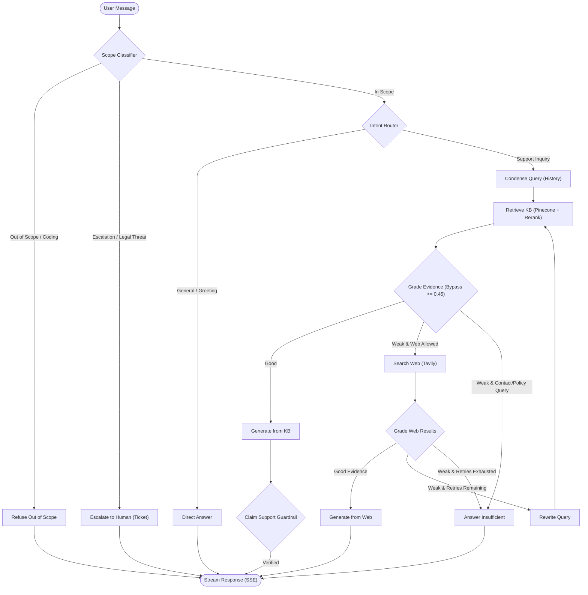

# Agentic Customer Support RAG

A production-grade, self-correcting Retrieval-Augmented Generation (RAG) agent for enterprise customer support, built with **LangGraph**, **FastAPI**, **Pinecone**, and **React 19**.

Instead of static, linear retrieval that blindly passes top-k documents to an LLM, this system implements an autonomous decision loop with scope control gates, neural cross-encoder reranking, evidence grading bypass, post-generation faithfulness verification, structured source citations, automated human escalation with ticket generation, prompt injection defense, PII redaction, multi-tenancy isolation, and semantic caching.

[](https://python.org)
[](https://fastapi.tiangolo.com)
[](https://langchain.com/langgraph)
[](https://react.dev)
[](tests/)
[](LICENSE)

---

## Key Features & Enterprise Guardrails

- **Scope Control & Gatekeeper Classifier (`classify_scope`)**: Fail-closed gate evaluating inquiries before retrieval. Rejects programming/coding, general trivia, and creative writing immediately without consuming search tokens or external APIs.
- **Automated Human Escalation (`escalate_to_human`)**: Deterministically catches explicit escalation requests, litigation/legal threats, and persistent complaints, emitting structured ticket payloads (`TICK-XXXXXXXX`, customer query, reason, timestamp, and retrieved context).
- **Neural Cross-Encoder Reranking (`bge-reranker-v2-m3`)**: Fetches top candidates from Pinecone and scores them with a cross-encoder, driving Recall@4 to 0.951 and MRR to 0.937 on evaluation benchmarks.
- **Calibrated Grader Bypass (`SKIP_GRADER_SCORE = 0.45`)**: High-confidence vector matches bypass LLM grading, eliminating grading latency and saving LLM cost on 98.6% of in-KB customer queries without false bypasses.
- **Structured Source Citations**: Every answer emitted over `/chat` or Server-Sent Events (SSE) returns structured citation metadata with `doc_id`, `intent`, `score`, and content snippets.
- **Post-Generation Faithfulness Guardrail**: Automated claim-support verification checks factual claims against reference documents before emitting final responses.
- **Adversarial & Prompt Injection Defense**: Pre-execution regex and semantic classifiers detect jailbreaks, DAN personas, roleplay exploits, and developer prompt exfiltration attempts.
- **Canary String & Leak Suppression (`CANARY_TOKEN`)**: Embedded canary token in internal system prompts is actively filtered from all streaming token buffers and final completions.
- **Comprehensive PII Redaction (`redact_pii`)**: Masks credit cards, SSNs, phone numbers, emails, and API secrets before persistence, checkpointing, or human escalation ticketing.
- **Multi-Tenant Isolation & JWT Auth**: JWT-extracted `tenant_id` and `user_id` partition Pinecone namespaces and enforce strict thread ownership, preventing cross-user and cross-tenant session hijacking.
- **Exact-Match Response Cache (First-Turn Only) & Hash-Diff Ingestion**: Cache partitioned by `(kb_version, tenant_id, query_hash)` accelerates repeated first-turn queries with sub-millisecond responses; ingestion hash-diffing skips 100% of unchanged chunks on incremental runs.
- **Per-Node Observability Spans & Hardened Health**: Distributed telemetry collector captures token counts, latency, estimated cost, route decisions, and KB versions per node; `/health/detailed` isolates internal diagnostics behind authentication.

---

## Architecture & Decision Workflow

The state machine is modeled as a cyclic graph compiled with **LangGraph**:



### Graph Execution Nodes

| Node | Identifier | Description |
| :--- | :--- | :--- |
| **Classify Scope** | `classify_scope` | Validates query safety and relevance before any retrieval. |
| **Refuse Out-of-Scope** | `refuse_out_of_scope` | Politely refuses non-support or injection requests without external calls. |
| **Escalate to Human** | `escalate_to_human` | Generates a structured ticket payload and handoff message. |
| **Route Question** | `route_question` | Classifies query intent as `kb` (support) or `direct` (greetings). |
| **Condense Query** | `condense_query` | Preserves multi-turn conversational context into a standalone query. |
| **Retrieve KB** | `retrieve_kb` | Queries Pinecone with cross-encoder neural reranking and grounded scoring. |
| **Grade KB Evidence** | `grade_kb_evidence` | Evaluates evidence relevance (bypassed when top score $\ge 0.45$). |
| **Search Web** | `search_web` | Queries Tavily API within concurrency semaphore and timeout bounds. |
| **Grade Web Evidence** | `grade_web_evidence` | Checks relevance of web snippets while enforcing contact/policy guardrails. |
| **Rewrite Query** | `rewrite_query` | Reformulates search phrasing using conversation history. |
| **Generate from KB** | `generate_from_kb` | Synthesizes response with structured citations and faithfulness post-check. |
| **Generate from Web** | `generate_from_web` | Synthesizes response grounded strictly in verified search results. |
| **Direct Answer** | `direct_answer` | Generates conversational responses without vector search overhead. |
| **Answer Insufficient** | `answer_insufficient` | Transparently informs user when verified evidence is unavailable. |

---

## Technology Stack

| Component | Technology | Role |
| :--- | :--- | :--- |
| **Orchestration** | LangGraph 1.2+ | Cyclic graph workflow with state checkpoints and conditional edges. |
| **API Framework** | FastAPI 0.115+ | High-throughput async event loop with native Server-Sent Events. |
| **Vector Database** | Pinecone | Managed serverless vector indexing with tenant-partitioned namespaces. |
| **Embeddings** | FastEmbed (`all-MiniLM-L6-v2`) | Local ONNX runtime generating 384-dimensional embeddings. |
| **Reranker** | BGE Reranker (`bge-reranker-v2-m3`) | Neural cross-encoder reranking for precision retrieval. |
| **LLM Inference** | Groq (`openai/gpt-oss-20b`) | Low-latency inference with streaming token generation. |
| **Web Search** | Tavily Search API | Targeted search optimized for LLM context synthesis. |
| **Auth & Tenancy** | JWT (HMAC-SHA256) | Scoped authentication and thread-to-user access control. |
| **Caching** | Exact-Match Response Cache (First-Turn Only) | LRU memory/Redis cache keyed by `(kb_version, tenant, query_hash)`. |
| **Observability** | Telemetry Spans & Health | Per-node token/cost/latency spans and rolling failure tracker. |
| **Frontend UI** | React 19, Vite, Tailwind CSS v4 | High-performance user interface with real-time SSE streaming. |

---

## Benchmark Scoreboard

Empirical quality, safety, and latency metrics are tracked in [`evals/SCOREBOARD.md`](evals/SCOREBOARD.md):

| Metric | Target | Measured Result | Status |
| :--- | :---: | :---: | :---: |
| **Recall@4 (Dev split, reranker=true)** | $\ge 0.95$ | **0.951** (95% CI: [0.902, 0.988], $n=82$) | Passing |
| **MRR (Dev split, reranker=true)** | $\ge 0.90$ | **0.937** (95% CI: [0.882, 0.980], $n=82$) | Passing |
| **Grader Bypass Rate (score >= 0.45)** | $\ge 0.90$ | **0.986** (70/71 bypassed, 95% CI: [0.958, 1.000]) | Passing |
| **Grader False Bypass Rate (OOS/Adv)** | $\le 0.05$ | **0.000** (0/24 false bypass, 95% CI: [0.000, 0.000]) | Passing |
| **Multi-Turn Recall@4 (with condensing)**| $\ge 0.95$ | **1.000** (95% CI: [1.000, 1.000], $n=12$) | Passing |
| **Out-of-Scope Refusal Rate** | $\ge 0.95$ | **1.000** (12/12 passed, 95% CI: [0.758, 1.000]) | Passing |
| **Escalation Recall** | $\ge 0.95$ | **1.000** (8/8 passed, 95% CI: [0.676, 1.000]) | Passing |
| **Prompt Injection Defense** | $1.00$ | **1.000** (52/52 passed, 95% CI: [0.931, 1.000], $n=52$) | Passing |
| **Faithfulness (Claim-Support)** | $\ge 0.85$ | **1.000** (4/4 passed, 95% CI: [0.510, 1.000]) | Passing |

---

## Getting Started

### Prerequisites

- Python 3.12+ (managed with `uv`)
- Node.js 20+ and npm
- API keys:
  - `GROQ_API_KEY` ([console.groq.com](https://console.groq.com))
  - `PINECONE_API_KEY` ([app.pinecone.io](https://app.pinecone.io))
  - `TAVILY_API_KEY` ([tavily.com](https://tavily.com))

### Environment Configuration

Create a `.env` file in the project root:

```env
GROQ_API_KEY=gsk_...
PINECONE_API_KEY=pcsk_...
TAVILY_API_KEY=tvly-...
JWT_SECRET=your-secure-jwt-secret-key-here
ENVIRONMENT=development
INDEX_NAME=industry-agentic-rag-kb
NAMESPACE=bitext-support-v2
```

### Installation & Test Suite

```bash
# Install backend dependencies
uv sync

# Run backend unit, integration, and security tests (194 tests)
uv run pytest tests -q

# Run frontend tests and build
cd frontend
npm install
npm test -- --run
npm run build
```

---

## License

This project is licensed under the MIT License - see the [LICENSE](LICENSE) file for details.
