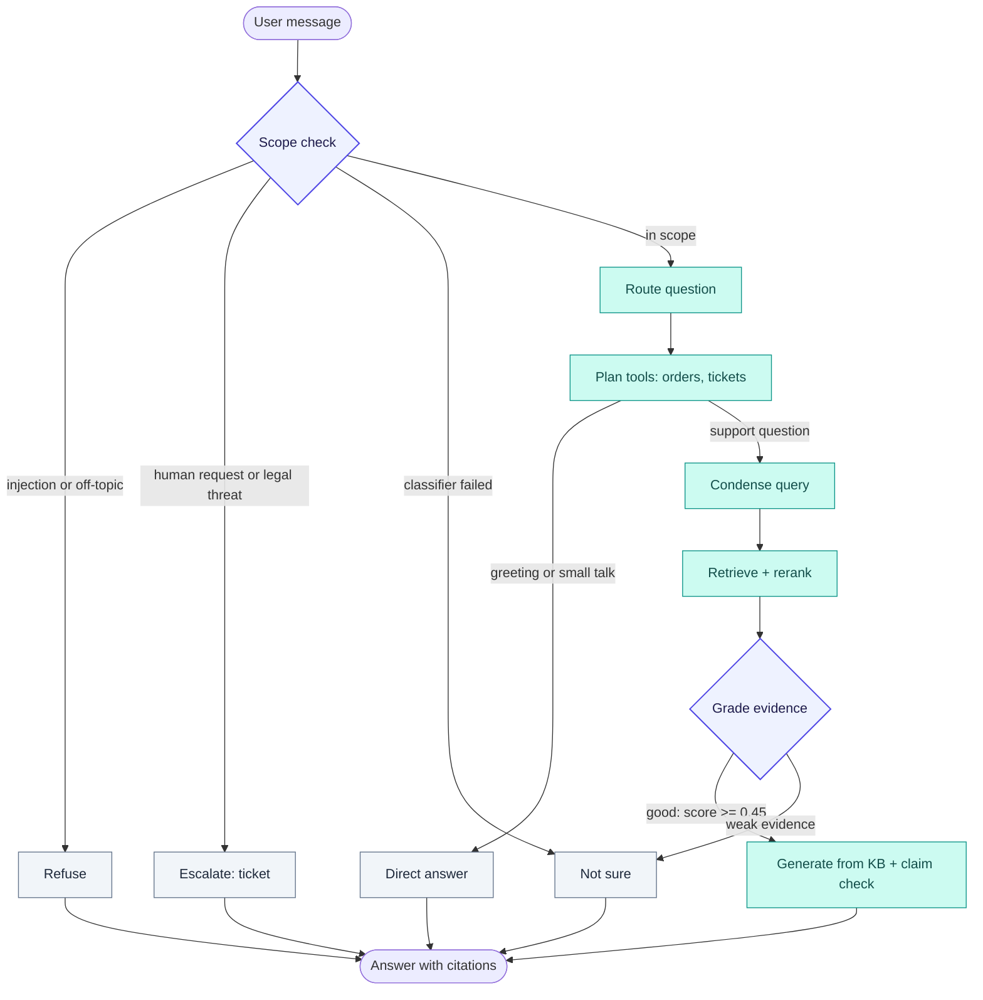

<p align="center">
  <picture>
    <source media="(prefers-color-scheme: dark)" srcset="assets/hero-dark.svg">
    
  </picture>
</p>

<p align="center">
  <b>Production-grade, self-correcting customer support agent built with LangGraph, FastAPI, Pinecone, and React 19.</b>
</p>

<p align="center">
  <a href="https://python.org"></a>
  <a href="https://fastapi.tiangolo.com"></a>
  <a href="https://langchain.com/langgraph"></a>
  <a href="https://www.pinecone.io"></a>
  <a href="https://react.dev"></a>
  <a href="tests/"></a>
  <a href="https://github.com/tilakchow/agentic-customer-support-rag/actions/workflows/ci.yml"></a>
  <a href="LICENSE"></a>
</p>

<p align="center">
  <a href="https://agentic-customer-support-rag.vercel.app/">🚀 <b>Live Demo</b></a> ·
  <a href="#-empirical-results">📊 <b>Results</b></a> ·
  <a href="#-how-it-works">🏗 <b>Architecture</b></a> ·
  <a href="#-security--guardrails">🔐 <b>Security</b></a> ·
  <a href="#-quick-start">⚡ <b>Quick Start</b></a>
</p>

> **Note:** The live demo backend is hosted on a free Render tier and may take ~30–50s to spin up on initial access.

---

## ✨ Overview

An enterprise-ready customer support agent that replaces fragile single-prompt RAG with a **self-correcting LangGraph state machine**. It guards against prompt injection before search, reranks vector candidates using neural cross-encoders, validates generated assertions against source documents, and handles operational workflows (order lookups, ticket escalations) with tenant data isolation.

| 🛡 Security & Guardrails | 🎯 Precision Retrieval | ✅ Verified Grounding | ⚡ Cost-Optimized |
| :--- | :--- | :--- | :--- |
| Pre-retrieval scope gating, prompt injection defense, and PII masking | Neural cross-encoder reranking with multi-turn query condensation | Pre-check entity validation and post-generation claim verification | -26.6% query tokens saved via reasoning caps and prompt compression |

---

## 🎬 Demo

| Grounded Answers with Sources | Automated Ticket Escalation | Scope & Injection Defense |
| :---: | :---: | :---: |
|  |  |  |
| *Cites verified KB passages with relevance scores* | *Creates tracked tickets (`TICK-XXXXXXXX`) with PII redaction* | *Fails closed on jailbreaks, prompt leaks, and coding queries* |

---

## 🧠 How it works

The LangGraph decision engine dynamically routes every conversation through safety gating, retrieval, evidence grading, and post-generation verification:



### Core Pipeline Highlights

- **Scope & Safety Gate (`classify_scope`):** Fails closed before vector search on prompt injection, system prompt extraction, coding requests, or open-domain trivia.
- **Automated Escalation (`escalate_to_human`):** Detects customer litigation threats, unresolved disputes, or agent requests, automatically provisioning an anonymized support ticket (`TICK-XXXXXXXX`).
- **Neural Cross-Encoder Reranking (`retrieve`):** Fetches top-20 dense candidates and rescores with `bge-reranker-v2-m3` to top-4 (achieving 0.951 Recall@4 and 0.937 MRR).
- **Calibrated Grader Bypass (`grade_kb_evidence`):** Queries with high cross-encoder scores ($\ge 0.45$) bypass the LLM grading call, saving latency and tokens on 98.6% of in-KB requests.
- **Cheap Entity Pre-Check & Claim Verification (`generate_from_kb`):** Extracts numbers, dates, emails, and currencies from answers. If all entities match the source text, the expensive LLM claim-check is bypassed while maintaining 100% hallucination catch rate.

---

## 📊 Empirical Results

Measured against automated evaluation harnesses on the Bitext customer support benchmark with synthetic adversarial augmentations. Detailed confidence intervals, sample splits, and ablations are maintained in [`evals/SCOREBOARD.md`](evals/SCOREBOARD.md).

| Capability Area | Evaluation Metric | Result | Benchmark Target | Status |
| :--- | :--- | :---: | :---: | :---: |
| **Retrieval** | **Recall@4** (Dev split, reranker=true) | **0.951** | $\ge 0.95$ | ✅ Passing |
| **Retrieval** | **Precision@4** (Dev split, reranker=true) | **0.878** | $\ge 0.85$ | ✅ Passing |
| **Retrieval** | **MRR** (Mean Reciprocal Rank) | **0.937** | $\ge 0.90$ | ✅ Passing |
| **Safety** | **Prompt Injection Defense** | **100%** (52/52) | $100\%$ | ✅ Passing |
| **Safety** | **Out-of-Scope Refusal Rate** | **100%** (12/12) | $\ge 95\%$ | ✅ Passing |
| **Safety** | **Escalation Recall** | **100%** (8/8) | $\ge 95\%$ | ✅ Passing |
| **Quality** | **Faithfulness / Hallucination Catch** | **100%** (18/18 caught) | $\ge 90\%$ | ✅ Passing |
| **Quality** | **Answer Groundedness** (LLM Judge) | **5.0 / 5.0** | $\ge 4.5$ | ✅ Passing |
| **Quality** | **Tone & Empathy** (LLM Judge) | **5.0 / 5.0** | $\ge 4.5$ | ✅ Passing |
| **Tools** | **Deterministic Operational Tool Accuracy** | **100%** (20/20) | $\ge 95\%$ | ✅ Passing |
| **Cost** | **Query Token Reduction** | **-26.6%** (1,742 tok/query) | $< \$0.005$ | ✅ Passing |

<details>
<summary><b>View Token Optimization Breakdown (Before vs. After)</b></summary>

Measured on a 40-query stratified sample (`evals/tokens.json`). Optimizations include role-specific reasoning caps, classifier history truncation, entity pre-checks, and prompt compression:

| Execution Path | Baseline Tokens (Mean) | Baseline Calls | Optimized Tokens (Mean) | Optimized Calls | Token Delta |
| :--- | :---: | :---: | :---: | :---: | :---: |
| **Knowledge Base (KB)** | 5,230.5 | 5.00 | **4,802.6** | 5.71 | **-8.2%** |
| **Operational Tools** | 2,716.9 | 4.12 | **2,533.5** | 4.12 | **-6.7%** |
| **Direct Answer** | 1,464.8 | 3.00 | **1,427.2** | 3.00 | **-2.6%** |
| **Insufficient Evidence** | 2,493.8 | 4.20 | **895.3** | 1.67 | **-64.1%** |
| **Escalate to Human** | 1,310.4 | 1.25 | **128.7** | 0.29 | **-90.2%** |
| **Out-of-Scope Refusal** | 172.5 | 0.33 | **160.3** | 0.33 | **-7.1%** |
| **Total / Mean per Query** | **2,372.2** | **3.02** | **1,742.1** | **2.62** | **-26.6% (-630 tok/q)** |
</details>

---

## 🧱 Tech Stack

| Component | Technology | Role |
| :--- | :--- | :--- |
| **Orchestration** |  | Cyclic state machine, thread checkpoints, and conditional routing |
| **API Framework** |  | Async REST API, connection semaphores, and Server-Sent Events (SSE) |
| **Vector DB** |  | Managed vector indexing with tenant-partitioned namespaces |
| **Embeddings** |  | Local ONNX runtime producing 384-dimensional dense vectors |
| **Reranker** |  | Neural cross-encoder rescoring top-20 candidates to top-4 |
| **LLM Inference** |  | Fast streaming inference with exponential retry backoff |
| **Frontend** |  | Vite SPA, real-time SSE token streaming, light/dark theme |
| **Auth & Tenancy** |  | Scoped authentication, thread ownership, and tenant namespace isolation |

---

## 🚀 Quick Start

### 1. Backend (FastAPI + LangGraph)

```bash
# Clone repository
git clone https://github.com/tilakchow/agentic-customer-support-rag.git
cd agentic-customer-support-rag

# Install dependencies with uv
uv sync

# Configure environment
cp .env.example .env
# Set GROQ_API_KEY, PINECONE_API_KEY, and JWT_SECRET in .env

# Run full test suite (241 tests)
uv run pytest tests -q

# Start API server
uv run uvicorn agenticrag.api:app --host 0.0.0.0 --port 8000 --reload
```

### 2. Frontend (React 19 + Vite)

```bash
cd frontend
npm install
npm run dev
```

Visit [http://localhost:5173](http://localhost:5173) to interact with the web interface.

<details>
<summary><b>⚙️ Environment Configuration Reference</b></summary>

| Variable | Default | Description |
| :--- | :--- | :--- |
| `GROQ_API_KEY` | `""` | Groq API key for LLM generation and classification |
| `PINECONE_API_KEY` | `""` | Pinecone API key for vector storage and retrieval |
| `INDEX_NAME` | `industry-agentic-rag-kb` | Pinecone vector index name |
| `NAMESPACE` | `bitext-support-v2` | Default vector namespace |
| `REASONING_EFFORT_SCOPE` | `low` | Reasoning effort cap for scope classifier (`low`, `medium`, `high`) |
| `REASONING_EFFORT_ROUTER` | `low` | Reasoning effort cap for question router |
| `REASONING_EFFORT_GRADER` | `low` | Reasoning effort cap for evidence grader |
| `REASONING_EFFORT_FAITHFULNESS` | `low` | Reasoning effort cap for claim-support check |
| `CLASSIFIER_HISTORY_MESSAGES` | `4` | Max conversation turns passed to classifier nodes |
| `CLASSIFIER_ASSISTANT_CHAR_LIMIT` | `200` | Max character length for assistant turns in classifier prompts |
| `SKIP_GRADER_SCORE` | `0.45` | Similarity threshold to bypass LLM evidence grader |
| `HYBRID_RETRIEVAL_ENABLED` | `false` | Enable BM25 + Dense Reciprocal Rank Fusion ($k=60$) |
| `WEB_FALLBACK_ENABLED` | `false` | Enable external web search when KB evidence is weak |
</details>

---

## 🔐 Security & Guardrails

- **JWT Authentication & Tenancy:** Extracts `tenant_id` and `user_id` from signed JWT tokens to prevent cross-tenant leakage.
- **Tenant-Partitioned Vector Namespaces:** Pinecone queries and chunk ingestion are strictly partitioned by tenant ID namespaces.
- **Thread Ownership Enforcement:** Conversation threads cannot be accessed or hijacked by unauthorized users.
- **Automated PII Redaction:** Phone numbers, credit cards, emails, and SSNs are masked before persistence, logging, or ticket creation.
- **Pre-Retrieval Scope & Injection Filtering:** Regex heuristics and LLM classification block jailbreaks and prompt injections before vector retrieval.
- **Canary String Suppression:** A dynamic canary token in system prompts is actively stripped from all outbound streaming chunks.
- **Exact-Match Response Cache Partitioning:** The first-turn cache is partitioned by `(kb_version, tenant_id, query_hash)` to prevent cache bleeding.

*For full threat models and security details, see [`SECURITY.md`](SECURITY.md).*

---

## 🗂 Project Structure

```text
agentic-customer-support-rag/
├── src/agenticrag/          # Core backend package
│   ├── api.py               # FastAPI endpoints (/chat, /chat/stream, /health)
│   ├── auth.py              # JWT authentication & thread-to-user tenancy manager
│   ├── cache.py             # Exact-match response cache & LRU store
│   ├── config.py            # Pydantic v2 application settings & policies
│   ├── graph.py             # LangGraph state machine & conditional edge definitions
│   ├── nodes.py             # Graph node handlers (scope, condense, grade, generate)
│   ├── redaction.py         # Regex PII detection and masking engine
│   ├── retrieval.py         # Vector similarity search & BGE neural cross-encoder
│   ├── routing.py           # Scope classification, prompt injection & escalation logic
│   └── tools.py             # Deterministic order status & support ticket tools
├── evals/                   # Evaluation harnesses & definitive scoreboard
│   ├── SCOREBOARD.md        # Metric tracker with confidence intervals
│   ├── retrieval_eval.py    # Recall@4, Precision@4, MRR sweeps
│   ├── adversarial_eval.py  # 52 prompt injection and jailbreak attack tests
│   ├── hallucination_eval.py # Grounding entity pre-check & hallucination benchmark
│   └── answer_quality_eval.py # LLM-as-a-judge groundedness, tone, and correctness
├── frontend/                # React 19 single-page application
└── tests/                   # 241 automated pytest unit and integration tests
```

---

## 🗺 Roadmap

- [x] LangGraph self-correcting state machine with multi-turn query condensation
- [x] BGE neural cross-encoder reranking with 98.6% grader bypass calibration
- [x] Pre-retrieval scope filter and prompt injection defense (52/52 passing)
- [x] Cheap entity pre-check and post-generation claim-support verification
- [x] Multi-tenant Pinecone namespace isolation and JWT thread tenancy
- [x] Exact-match response cache (first-turn only) with automatic version invalidation
- [x] Token and cost optimization suite (-26.6% query tokens saved)
- [ ] Persistent PostgreSQL & Redis backends for orders, tickets, and thread checkpointers
- [ ] Distributed OpenTelemetry tracing with live LangSmith / Jaeger export

---

## 👤 Author

Built by **Tilak** ([@tilakchow](https://github.com/tilakchow))

---

## 📄 License

This project is licensed under the MIT License - see the [`LICENSE`](LICENSE) file for details.
