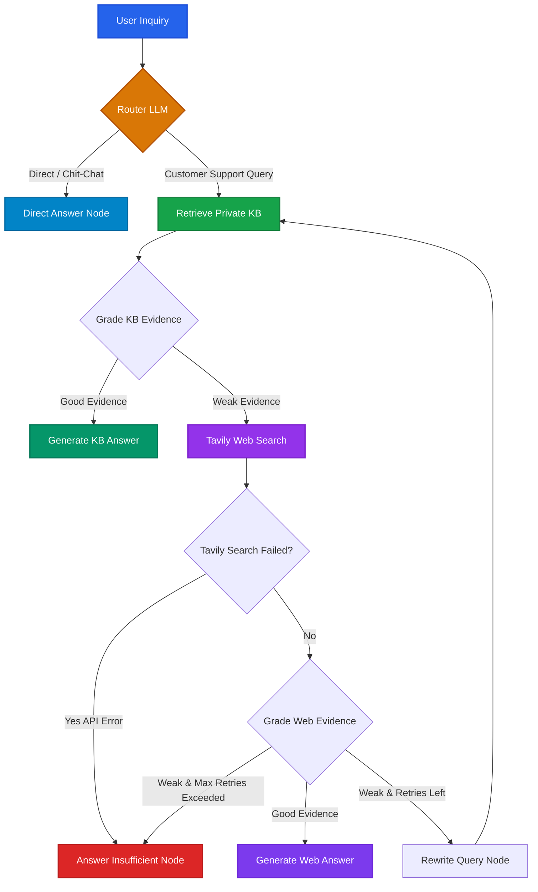

<div align="center">
  
# 🤖 Agentic RAG — Customer Support AI
  
**An enterprise-grade, self-correcting Retrieval-Augmented Generation (RAG) system with dynamic routing, knowledge base fallback, query rewriting, and real-time streaming.**

[](https://python.org)
[](https://fastapi.tiangolo.com)
[](https://langchain.com/langgraph)
[](https://langchain.com)
[](https://pinecone.io)
[](https://groq.com)
[](https://tavily.com)
[](tests/)
[](LICENSE)

</div>

---

## 🌟 Overview

**Agentic RAG Customer Support** is a production-hardened intelligent assistant built using **LangGraph**, **LangChain**, **FastAPI**, and **React 19**. 

Unlike conventional static RAG architectures that blindly inject database lookups into prompts, this agentic architecture acts as an autonomous reasoning loop:
1. **Intelligent Query Routing**: Distinguishes between conversational chit-chat / greetings and customer support inquiries.
2. **Private Knowledge Base Retrieval**: Queries a Pinecone vector database populated with domain documentation.
3. **Automated Evidence Grading**: An LLM grader evaluates whether retrieved context is sufficient and relevant.
4. **Autonomous Web Search Fallback**: Seamlessly switches to real-time Tavily web search if internal documents are missing or stale.
5. **Self-Correction & Query Rewriting**: Rewrites ambiguous search queries and retries retrieval up to configurable retry limits.
6. **Graceful Error & Context Handling**: Prevents API error leakages and falls back cleanly if information cannot be verified.
7. **Real-time SSE Streaming**: Emits live reasoning steps (`status`), token chunks (`token`), and structured conclusions (`final`) to the frontend.

---

## 🏗️ Architecture & Decision Graph

The agent's state machine is compiled with **LangGraph**:



### Graph Execution Nodes

| Node Name | Identifier | Purpose |
| :--- | :--- | :--- |
| **Route Question** | `route_question` | Classifies query intent as `kb` (technical support) or `direct` (greetings/general). |
| **Retrieve KB** | `retrieve_kb` | Fetches top matching vector embeddings from Pinecone index. |
| **Grade KB Evidence** | `grade_kb_evidence` | Evaluates if private documents are sufficient to answer the prompt. |
| **Search Web** | `search_web` | Queries Tavily API for real-time web results if KB evidence is weak. |
| **Grade Web Evidence** | `grade_web_evidence` | Evaluates accuracy and relevance of external search snippets. |
| **Rewrite Query** | `rewrite_query` | Reformulates search terms using prior context when retrieval fails. |
| **Generate From KB** | `generate_from_kb` | Synthesizes customer answer grounded strictly in private KB context. |
| **Generate From Web** | `generate_from_web` | Synthesizes response grounded strictly in verified web search results. |
| **Direct Answer** | `direct_answer` | Delivers quick polite answers for general inquiries and greetings. |
| **Answer Insufficient** | `answer_insufficient` | Gracefully notifies the user when evidence is insufficient or external search fails. |

---

## 🛡️ Production Hardening & Security

This codebase implements production-grade security and reliability patterns:

- ⚡ **Async-First Concurrency**: All LangGraph invocations use `await agent_app.ainvoke(...)` and `agent_app.astream(...)`, preventing event-loop serialization under concurrent traffic.
- 🔒 **API Key Authentication**: Configurable `X-API-Key` header authentication protecting `/chat` and `/chat/stream`.
- 🛑 **Rate Limiting**: Integrated **SlowAPI** client throttling (default `20/minute` per client IP).
- 📏 **Input Caps & Sanitization**: Validates user messages (1 to 1,500 characters), trims whitespace, and prevents blank session hijacking via clean UUID generation.
- 🛡️ **Tavily Error Containment**: Traps web search API timeouts or rate limits into a explicit `web_search_failed` flag, preventing error traces from leaking into generation prompts or being evaluated as factual data.
- 🧩 **Zero Import Side-Effects**: Lazy client factories (`get_llm()`, `get_retriever()`, `get_web_search()`) and `pydantic-settings` validation executed inside FastAPI's `lifespan` handler. Code can be imported and tested offline without network connectivity.
- 🔁 **Deterministic Ingestion**: Document chunks are hashed deterministically (`doc_hash_chunk_idx`), preventing vector duplication upon repeated ingest runs.
- 🌐 **Strict CORS Policies**: Preconfigured allowed origins preventing unauthorized cross-origin requests.

---

## 🧰 Tech Stack

| Layer | Technologies |
| :--- | :--- |
| **Backend Framework** | FastAPI 0.143+, Uvicorn 0.54+, Pydantic v2, Pydantic Settings |
| **Agent Orchestration** | LangGraph 1.2+, LangChain 1.3+ |
| **LLM Inference** | Groq LPU (`openai/gpt-oss-20b` or LLaMA-3.3-70b-versatile) |
| **Vector Database** | Pinecone Vector Database (`pinecone>=7.3.0`) |
| **Embeddings** | FastEmbed (`sentence-transformers/all-MiniLM-L6-v2`, 384 dimensions) |
| **Search Engine** | Tavily Search API (`langchain-tavily>=0.2.18`) |
| **Rate Limiter** | SlowAPI 0.1.10+ |
| **Frontend UI** | React 19, TypeScript, Vite, Tailwind CSS v4, Lucide Icons |
| **Packaging & CI** | Astral `uv`, GitHub Actions, Pytest, HTTPX |

---

## 📂 Project Structure

```
Agentic-RAG/
├── .github/workflows/
│   └── ci.yml               # Automated CI pipeline running pytest on pull requests & main
├── src/agenticrag/
│   ├── __init__.py          # Package export and versioning
│   ├── api.py               # FastAPI application with SSE streaming, auth, and rate limits
│   ├── cli.py               # Command-line interface (`agenticrag serve`, `agenticrag ingest`)
│   ├── config.py            # Pydantic Settings, lazy client factories, and graph schemas
│   ├── graph.py             # LangGraph state machine assembly and compilation
│   ├── ingest.py            # Idempotent Pinecone dataset ingestion pipeline
│   ├── nodes.py             # Graph node implementations, node metadata, and routing logic
│   └── prompts.py           # Domain prompts and persona instructions
├── frontend/                # Modern React 19 + TypeScript + Tailwind v4 UI
│   ├── src/                 # Chat interface, SSE stream parser, source badges
│   └── package.json
├── tests/
│   ├── test_api.py          # API validation, auth, input caps, and thread_id tests
│   ├── test_routing.py      # Pure node decision logic and routing tests
│   └── test_sse_contract.py # Server-Sent Events contract and payload tests
├── Dockerfile               # Production container configured for Hugging Face Spaces & Render
├── pyproject.toml           # Project dependencies managed via `uv`
├── test_run.py              # Lightweight smoke test verification script
└── README.md
```

---

## ⚙️ Configuration & Environment Variables

Create a `.env` file in the project root:

```env
# Required API Keys
GROQ_API_KEY=gsk_your_groq_api_key_here
PINECONE_API_KEY=pcsk_your_pinecone_api_key_here
TAVILY_API_KEY=tvly-your_tavily_api_key_here

# Optional: API Secret for Client Authentication (leave blank to allow public access)
API_KEY=your_optional_secret_api_key

# Optional: Pinecone Configuration
INDEX_NAME=industry-agentic-rag-kb
NAMESPACE=bitext-support
EMBEDDING_MODEL=sentence-transformers/all-MiniLM-L6-v2

# Optional: Model & Agent Tuning
GROQ_MODEL=openai/gpt-oss-20b
MAX_RETRIES=1
RATE_LIMIT=20/minute
MAX_MESSAGE_LENGTH=1500
```

---

## 🚀 Quick Start Guide

### 1. Prerequisites
- **Python 3.14+**
- **uv** (Astral's fast Python package manager):
  ```bash
  # Windows (PowerShell)
  powershell -ExecutionPolicy ByPass -c "irm https://astral.sh/uv/install.ps1 | iex"
  # macOS / Linux
  curl -LsSf https://astral.sh/uv/install.sh | sh
  ```
- **Node.js 18+** & npm (for frontend)

### 2. Installation
Clone the repository and install all dependencies:
```bash
git clone https://github.com/tilakchow/agentic-customer-support-rag.git
cd agentic-customer-support-rag

# Sync backend virtual environment
uv sync
```

### 3. Knowledge Base Ingestion
Populate your Pinecone vector database with domain knowledge (idempotent with deterministic hashes):
```bash
uv run agenticrag ingest
```

### 4. Run the Backend API
Start the FastAPI server via the CLI tool:
```bash
# Development mode with hot-reloading
uv run agenticrag serve --port 8000 --reload
```
Or directly with Uvicorn:
```bash
uv run uvicorn agenticrag.api:app --reload --host 0.0.0.0 --port 8000
```

- **Interactive API Docs (Swagger)**: `http://localhost:8000/docs`
- **Health Check Endpoint**: `http://localhost:8000/health`
- **Knowledge Base Stats**: `http://localhost:8000/kb/info`

### 5. Run the Frontend UI
In a separate terminal:
```bash
cd frontend
npm install
npm run dev
```
Open **`http://localhost:5173`** in your browser.

---

## 🔌 API Endpoints & Contracts

### `POST /chat` — Synchronous Chat
```json
// Request
{
  "message": "How do I update my billing payment method?",
  "thread_id": "optional-custom-session-id"
}

// Response
{
  "reply": "To update your payment method, navigate to...",
  "source_used": "private_kb",
  "thread_id": "optional-custom-session-id"
}
```

### `POST /chat/stream` — Real-Time SSE Stream
Streams Server-Sent Events representing reasoning transitions and tokens:
- **`status`**: Agent step update (e.g., `{"node": "retrieve_kb", "message": "Searching private knowledge base..."}`)
- **`token`**: Real-time token chunk generated by the LLM
- **`final`**: Final structured response payload containing `reply`, `source_used`, and `thread_id`
- **`error`**: Masked error notification in case of exceptions

---

## 🧪 Testing & Quality Assurance

The codebase includes comprehensive unit tests and contract validations:

```bash
# Run the complete test suite
uv run pytest tests/ -v
```

```
======================== 20 passed in 0.79s ========================
tests/test_api.py::test_health_check PASSED
tests/test_api.py::test_kb_info_endpoint PASSED
tests/test_api.py::test_chat_empty_message_validation PASSED
tests/test_api.py::test_chat_whitespace_message_validation PASSED
tests/test_api.py::test_chat_message_length_limit PASSED
tests/test_api.py::test_clean_thread_id PASSED
tests/test_routing.py::test_route_after_router_kb PASSED
tests/test_routing.py::test_route_after_router_direct PASSED
tests/test_routing.py::test_decide_after_kb_grade_good PASSED
tests/test_routing.py::test_decide_after_kb_grade_weak PASSED
tests/test_routing.py::test_decide_after_web_grade_failure PASSED
tests/test_routing.py::test_decide_after_web_grade_good PASSED
tests/test_routing.py::test_decide_after_web_grade_retry PASSED
tests/test_routing.py::test_decide_after_web_grade_max_retries PASSED
tests/test_sse_contract.py::test_status_event_contract PASSED
tests/test_sse_contract.py::test_generation_node_contract PASSED
tests/test_sse_contract.py::test_sse_event_payload_schemas PASSED
```

Run the standalone smoke test:
```bash
uv run python test_run.py
```

---

## 🐳 Docker & Hugging Face Spaces Deployment

The repository includes an optimized multi-stage `Dockerfile` configured to run seamlessly on Hugging Face Spaces (port 7860) or any containerized cloud host (Render, Fly.io, AWS ECS):

```bash
# Build Docker image
docker build -t agentic-customer-support-rag .

# Run container locally
docker run -p 7860:7860 \
  -e GROQ_API_KEY="your_groq_key" \
  -e PINECONE_API_KEY="your_pinecone_key" \
  -e TAVILY_API_KEY="your_tavily_key" \
  agentic-customer-support-rag
```

---

## 👨‍💻 Author

**Tilak chowdary**  
- **Email**: [tilakchowdary5@gmail.com](mailto:tilakchowdary5@gmail.com)  
- **Repository**: [tilakchow/Agentic-RAG](https://github.com/tilakchow/agentic-customer-support-rag)
