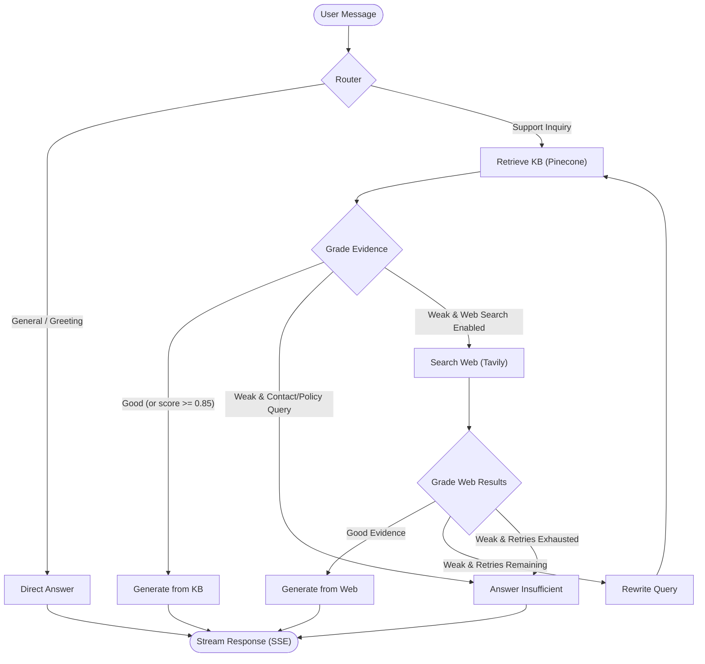

# Agentic Customer Support RAG

A production-ready, self-correcting Retrieval-Augmented Generation (RAG) agent for customer support, built with **LangGraph**, **FastAPI**, **Pinecone**, and **React 19**.

Instead of static, linear retrieval that blindly passes top-k documents to an LLM, this system implements an autonomous decision loop: it routes inquiries, verifies retrieved evidence with automated grading, falls back to web search when internal documents are insufficient, self-corrects ambiguous queries, and streams real-time reasoning progress and tokens over Server-Sent Events (SSE).

[](https://python.org)
[](https://fastapi.tiangolo.com)
[](https://langchain.com/langgraph)
[](https://react.dev)
[](tests/)
[](tests/)
[](LICENSE)

---

## Key Features

- **Autonomous Intent Routing**: Distinguishes between conversational pleasantries (routed directly) and customer support queries (routed to retrieval).
- **Private Knowledge Base Retrieval**: Performs dense vector search against Pinecone embeddings with similarity score tracking.
- **Evidence Grading with Threshold Bypass**: Evaluates evidence relevance before synthesis; high-confidence vector matches (`score >= 0.85`) bypass the LLM grader to reduce token latency.
- **Web Search Fallback**: Seamlessly queries Tavily with strict timeouts and concurrency caps when internal knowledge base coverage is weak.
- **Hallucination Guardrails**: Blocks open web searches for internal company contact channels and proprietary policies to prevent external contact hallucination.
- **Self-Correction & Query Rewriting**: Reformulates ambiguous customer queries and retries retrieval up to configurable limits.
- **Prompt Injection Defense**: Isolates untrusted retrieved text within delimited `<context>` blocks with passive data instructions and tag escaping.
- **Bounded Session Persistence**: Backed by async SQLite (`aiosqlite`), with sliding-window message trimming (`MAX_THREAD_MESSAGES`) to prevent unbounded memory growth.
- **Real-Time Token & Event Streaming**: Emits status events, token deltas, and structured citations to the React interface over Server-Sent Events (SSE).
- **Hardened Deployment Architecture**: Decoupled Vercel Edge proxies protect backend credentials while enforcing per-IP sliding-window rate limiting.

---

## Architecture & Decision Workflow

The state machine is modeled as a cyclic graph compiled with **LangGraph**:



### Graph Execution Nodes

| Node | Identifier | Description |
| :--- | :--- | :--- |
| **Route Question** | `route_question` | Classifies query intent as `kb` (domain support) or `direct` (greetings). |
| **Retrieve KB** | `retrieve_kb` | Queries Pinecone index asynchronously (`asyncio.to_thread`) with similarity scores. |
| **Grade KB Evidence** | `grade_kb_evidence` | Evaluates document relevance (bypassed if top similarity >= `SKIP_GRADER_SCORE`). |
| **Search Web** | `search_web` | Queries Tavily API within concurrency semaphore and timeout bounds. |
| **Grade Web Evidence** | `grade_web_evidence` | Checks relevance of web snippets while enforcing contact/policy guardrails. |
| **Rewrite Query** | `rewrite_query` | Reformulates search phrasing using conversation history. |
| **Generate from KB** | `generate_from_kb` | Synthesizes customer answer grounded strictly in verified internal documents. |
| **Generate from Web** | `generate_from_web` | Synthesizes response grounded strictly in verified search results. |
| **Direct Answer** | `direct_answer` | Generates conversational responses without vector search overhead. |
| **Answer Insufficient** | `answer_insufficient` | Transparently informs user when verified evidence is unavailable. |

---

## Technology Stack

| Component | Technology | Why Chosen |
| :--- | :--- | :--- |
| **Agent Orchestration** | LangGraph 1.2+ | Enables cyclic graph workflows with conditional branching and checkpoint persistence, unlike linear chains. |
| **API Framework** | FastAPI 0.115+ | High-throughput asynchronous event loop support, native Server-Sent Events, and Pydantic v2 data validation. |
| **Vector Database** | Pinecone | Managed serverless vector indexing with sub-50ms latency and metadata filtering. |
| **Embedding Model** | FastEmbed (`all-MiniLM-L6-v2`) | Local ONNX runtime execution generating 384-dimensional embeddings without external API costs or rate limits. |
| **LLM Inference** | Groq (`openai/gpt-oss-20b`) | Ultra-low time-to-first-token (TTFT) and high token generation speed for real-time customer streaming. |
| **Web Search** | Tavily Search API | Search engine optimized specifically for LLM extraction, returning synthesized content rather than raw HTML. |
| **State Checkpointing** | Async SQLite (`aiosqlite`) | Zero-dependency local persistence for conversation memory across multiple turns. |
| **Rate Limiting** | SlowAPI & Edge sliding-window | In-memory sliding-window throttling at the edge and per-IP key bucketing at the backend. |
| **Frontend UI** | React 19, Vite, Tailwind CSS v4 | Modern React concurrent rendering, fast HMR build tooling, and lightweight styling. |
| **Python Tooling** | Astral `uv`, Ruff, Mypy | Sub-second package resolution, reproducible lockfiles, fast linting, and strict type checking. |

---

## Getting Started

### Prerequisites

- **Python 3.12+** and [uv](https://docs.astral.sh/uv/) package manager
- **Node.js 20+** and npm
- **API Keys**:
  - [Groq API Key](https://console.groq.com/) (LLM inference)
  - [Pinecone API Key](https://www.pinecone.io/) (Vector search)
  - [Tavily API Key](https://tavily.com/) (Web search fallback)

### 1. Repository Setup

```bash
git clone https://github.com/tilakchow/agentic-customer-support-rag.git
cd agentic-customer-support-rag
```

### 2. Backend Installation & Configuration

```bash
# Install Python dependencies using uv
uv sync --extra ingest

# Configure environment variables
cp .env.example .env
```

Edit `.env` and provide your API keys:

```env
GROQ_API_KEY="gsk_..."
PINECONE_API_KEY="pcsk_..."
TAVILY_API_KEY="tvly-..."
```

*(Optional)* Ingest knowledge base sample documents into your Pinecone index:

```bash
uv run agenticrag ingest
```

Run the backend server:

```bash
uv run agenticrag serve --reload
```

The API will be available at `http://localhost:8000` (interactive documentation at `http://localhost:8000/docs`).

### 3. Frontend Installation & Run

In a separate terminal:

```bash
cd frontend
npm install
npm run dev
```

The user interface will be accessible at `http://localhost:5173`.

---

## Environment Variables

| Variable | Default | Required | Purpose |
| :--- | :--- | :---: | :--- |
| `GROQ_API_KEY` | `""` | Yes | Groq API key for LLM generation and routing. |
| `PINECONE_API_KEY` | `""` | Yes | Pinecone API key for vector store retrieval. |
| `TAVILY_API_KEY` | `""` | Yes | Tavily API key for web search fallback. |
| `API_KEY` | `""` | Optional | Shared secret for `X-API-Key` authentication (required if `ENVIRONMENT=production`). |
| `ENVIRONMENT` | `development` | Optional | Set to `production` to enforce persistent checkpointers and API authentication. |
| `CHECKPOINT_DB` | `""` | Prod only | File path for SQLite checkpointer (e.g. `checkpoints.sqlite`). |
| `ALLOW_IN_MEMORY_CHECKPOINTS` | `true` (dev) / `false` (prod) | Optional | Permits in-memory ephemeral checkpointer when persistent storage is unavailable. |
| `TRUSTED_PROXIES` | `""` | Optional | Comma-separated list of trusted reverse proxy IPs for spoof-safe client IP resolution. |
| `RATE_LIMIT` | `20/minute` | Optional | SlowAPI rate limit for conversational `/chat` routes. |
| `SKIP_GRADER_SCORE` | `0.85` | Optional | Similarity score threshold to bypass LLM evidence grading. |
| `MAX_THREAD_MESSAGES` | `40` | Optional | Maximum retained conversation turns per thread before pruning. |
| `BACKEND_URL` | `http://localhost:8000` | Optional | Backend target URL used by Vercel edge proxy functions. |

---

## Running Verification & Tests

The repository maintains an automated test suite with **146 tests** covering unit behavior, SSE streaming contracts, security edge cases, and RAG evaluation benchmarks at **95% line coverage**.

```bash
# Run backend test suite with coverage enforcement (>= 85%)
uv run pytest tests/ -v --cov=agenticrag --cov-fail-under=85

# Linting and formatting checks
uv run ruff check .
uv run ruff format --check .

# Static type checking
uv run mypy src/

# Frontend test suite and type compilation
cd frontend
npm test
npm run lint
npm run build
```

---

## Deployment Architecture

### Option 1: Unified Container (Docker)

Suitable for container hosting services (Render, Hugging Face Spaces, Fly.io, or AWS ECS):

```bash
# Build image
docker build -t agentic-rag .

# Run container with persistent checkpointer volume
docker run -p 7860:7860 \
  -e GROQ_API_KEY="your_groq_key" \
  -e PINECONE_API_KEY="your_pinecone_key" \
  -e TAVILY_API_KEY="your_tavily_key" \
  -e API_KEY="your_production_secret" \
  -e ENVIRONMENT="production" \
  -e CHECKPOINT_DB="/app/data/checkpoints.sqlite" \
  agentic-rag
```

### Option 2: Split Architecture (Vercel Frontend + Managed Backend)

- **Backend**: Deploy FastAPI on a container host (Render, Fly.io) with persistent disk volume for `CHECKPOINT_DB` and `API_KEY` set.
- **Frontend on Vercel**:
  - Set **Root Directory** in Vercel project settings to `frontend`.
  - Configure environment variables in Vercel Dashboard:
    - `BACKEND_URL`: URL of the deployed FastAPI backend.
    - `API_KEY`: The matching secret key (injected securely server-side by `frontend/api/_proxy.ts`).
  - Edge proxy routes (`/api/chat`, `/api/chat-stream`, `/api/health`, `/api/kb/*`) handle client rate limiting and forward requests without exposing credentials to browser clients.

---

## Design Trade-offs & Limitations

1. **Demonstration Dataset Scope**: The knowledge base ingestion pipeline indexes a curated 500-sample slice of the Bitext customer support dataset to maintain a lean, cost-free vector database index footprint.
2. **External Search Quotas**: Tavily search fallback is concurrency-capped (5 concurrent calls) and throttled by a 15-second timeout; extensive external lookups consume search API quota.
3. **Single-Node State Persistence**: The default state checkpointer uses `aiosqlite`, which is suited for single-container or vertical scaling. Distributed, multi-replica horizontal clustering requires migrating to `AsyncPostgresSaver` backed by PostgreSQL.
4. **Third-Party Provider Latency**: Overall response latency depends on external API response times (Groq, Pinecone, and Tavily). During provider outages, the system fails gracefully with tracked error metrics exposed at `/health`.

---

## License

This project is licensed under the [MIT License](LICENSE).
